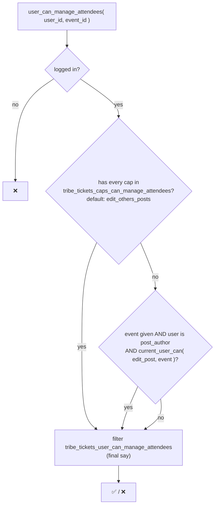
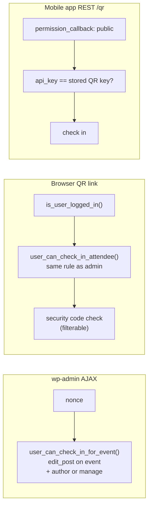
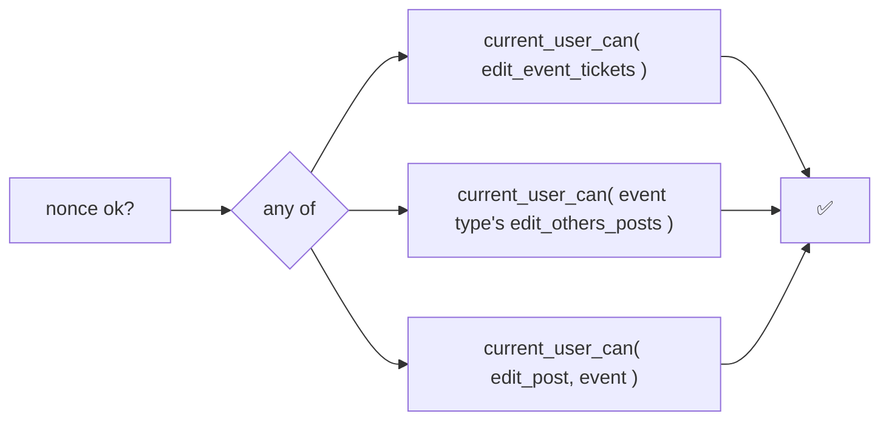
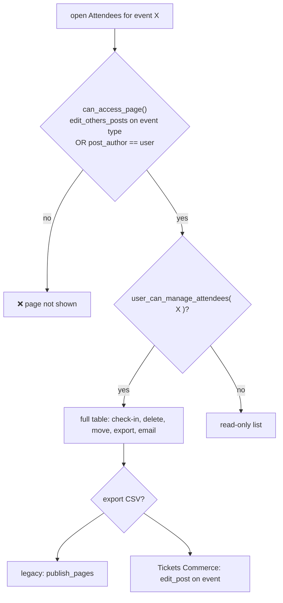

# RBAC in Event Tickets

> **TL;DR**
>
> - Event Tickets defines **no roles** and grants **no capabilities**. Tickets, attendees and RSVPs are plain `post`-cap post types.
> - The one question that decides almost everything: **"Can you edit other people's posts, or did you write this event?"** That is `user_can_manage_attendees()`.
> - **Event authors** (Authors, Contributors) get a reduced, own-events-only view of attendees and orders.
> - The **QR app** authenticates with an **API key**, not a user. The **browser** QR flow uses normal capabilities.
> - Buying and RSVPing is **public** unless the "Login requirement" setting says otherwise.

Suite overview (how caps flow between Common, TEC, ET and the add-ons) lives in `tribe-common/docs/RBAC`.

---

## How to read this page

- **Support / QA**: read [Who can do what](#who-can-do-what) and [Gotchas](#gotchas). Stop there.
- **Engineers**: continue to [How it works](#how-it-works), [Where it lives in code](#where-it-lives-in-code) and [How to change it](#how-to-change-it).
- Each section stands on its own. Skipping is fine.

---

## Who can do what

Default WordPress roles, no customisation. "own" = only for events the user authored. ✅ = can, ❌ = cannot.

| Feature | What is checked | Admin | Editor | Author | Contributor | Subscriber | Logged-out |
|---|---|---|---|---|---|---|---|
| Create / edit tickets on **own** event | `edit_post` on the event | ✅ | ✅ | ✅ | own drafts | ❌ | ❌ |
| Create / edit tickets on **others'** events | `edit_others_posts` | ✅ | ✅ | ❌ | ❌ | ❌ | ❌ |
| Attendees report, **own** event | author, or `edit_others_posts` | ✅ | ✅ | ✅ | ✅ | ❌ | ❌ |
| Attendees report, **others'** events | `edit_others_posts` | ✅ | ✅ | ❌ | ❌ | ❌ | ❌ |
| "All Attendees" admin page | `user_can_manage_attendees()` with no event | ✅ | ✅ | ❌ | ❌ | ❌ | ❌ |
| Check in / undo check-in | `edit_post` on event + (author or manage) | ✅ | ✅ | own | own | ❌ | ❌ |
| Export attendees CSV (legacy report) | `publish_pages` | ✅ | ✅ | ❌ | ❌ | ❌ | ❌ |
| Export attendees CSV (Tickets Commerce report) | `edit_post` on event | ✅ | ✅ | own | own | ❌ | ❌ |
| Email attendee list | `edit_posts`, or `read` for the author | ✅ | ✅ | ✅ | ✅ | ❌ | ❌ |
| Move tickets / attendees (bulk action) | `user_can_manage_attendees()` | ✅ | ✅ | own | own | ❌ | ❌ |
| Tickets Commerce › Orders page | `manage_options` (filterable) | ✅ | ❌ | ❌ | ❌ | ❌ | ❌ |
| Per-event orders report | author, or `edit_others_posts` | ✅ | ✅ | own | own | ❌ | ❌ |
| Tickets settings, gateways (Stripe, PayPal, Square) | `manage_options` | ✅ | ❌ | ❌ | ❌ | ❌ | ❌ |
| Seating: maps, layouts, seat types | `manage_options` | ✅ | ❌ | ❌ | ❌ | ❌ | ❌ |
| Seating: assign a layout to an event | `edit_post` on the event | ✅ | ✅ | own | own | ❌ | ❌ |
| QR app check-in (REST) | API key | key | key | key | key | key | key |
| Browser QR check-in link | logged in + check-in rule above | ✅ | ✅ | own | own | ❌ | ❌ |
| RSVP / buy a ticket | login only if the setting requires it | ✅ | ✅ | ✅ | ✅ | ✅ | setting |
| My Tickets page (edit own attendee info) | logged in + owns the attendee | ✅ | ✅ | ✅ | ✅ | ✅ | ❌ |
| View order success page | guest order: anyone; user order: owner or `manage_options` | ✅ | own | own | own | own | guest |

> ⚠️ "own" for Contributors means the event is theirs **and** they can still `edit_post` it. Once an event is published, a Contributor loses `edit_post` on it and the attendee tools go with it.

---

## How it works

### 1. The central question: `user_can_manage_attendees()`

Nearly every attendee and ticket tool routes through this one helper in `Tribe__Tickets__Attendees`.

- Admins and Editors pass on the first branch.
- Authors pass only for their own events.
- Called with **no event** (the "All Attendees" page, the Glance widget) only the cap branch can pass.

### 2. Three ways to check in, three different gates

- The QR API key lives in the option `tickets-plus-qr-options-api-key`. Regenerating it needs `manage_options`.
- RSVP `checkin()` / `uncheckin()` skip the manage check when called from the QR or app path, because the key already authenticated the request.

### 3. Ticket editor: a three-way OR

Adding, editing, deleting or duplicating a ticket (classic metabox AJAX and the block editor REST route) goes through `Metabox::has_permission()`.

- `edit_event_tickets` is **never granted by Event Tickets**. Community Events grants it to front-end submitters. On a plain ET site it is a no-op branch.
- The block editor routes under `tribe/tickets/v1/tickets` register with a public `permission_callback`; the real check is this same method inside the handler.

### 4. Who sees what on an attendees report

The submenu itself is registered with `edit_posts`, dropping to `read` when the user is the event author. That is what lets an Author reach the page at all.

### 5. REST: two APIs, two rules

| API | Read | Write | "Manage" access |
|---|---|---|---|
| Legacy `tribe/tickets/v1` | public (`/tickets`, `/attendees`, `/qr`, `/cart` GET) | `/attendees` POST and PUT need manage access | `edit_users` OR `tribe_manage_attendees` OR request `api_key` equals the QR key |
| New `tec/v1` tickets | public (`guest_can_read()` is true); single reads also check the parent event is readable | create / update need `edit_post` on the **parent event** | n/a |

Without manage access the legacy API trims private fields (purchaser email, security codes) from the output.

### 6. Logged-out users

- **RSVP and purchase** are public by default. The setting `ticket-authentication-requirements` can require login for RSVPs (`event-tickets_rsvp`) or for all tickets (`event-tickets_all`). The setting feeds a `must_login` flag into the templates.
- **Private or password-protected events** refuse RSVP rendering for users without `read_private_posts`.
- **Order success page** shows guest orders (purchaser user ID 0) to anyone with the link. Orders tied to a user show only to that user or to `manage_options`.
- **My Tickets** redirects logged-out users. Edits save only for attendee IDs the current user owns on that post.
- **Gateway order updates** (Stripe, PayPal, Square) are owned by the cart cookie or an order-scoped credential, not by a WordPress user.

---

## Where it lives in code

Paths are relative to `src/`. Search for the method name; line numbers move.

| Area | File | What to look for |
|---|---|---|
| Central helper | `Tribe/Attendees.php` | `user_can_manage_attendees()`, `user_authored_editable_event()` |
| Report page access | `Tribe/Attendees.php` | `can_access_page()`, `register_page()` (`edit_posts` → `read` for author) |
| CSV export (legacy) | `Tribe/Attendees.php` | `publish_pages` + filter `tec_tickets_attendees_user_can_export_csv` |
| Email attendee list | `Tribe/Attendees.php` | `has_attendees_list_access()`, `user_can()` |
| Check-in rule | `Tribe/Attendees.php` | `user_can_check_in_attendee()`, `user_can_check_in_for_event()` |
| Check-in AJAX | `Tribe/Tickets/Metabox.php` | `ajax_handler_attendee_checkin()`, `ajax_handler_attendee_uncheckin()` |
| Browser QR flow | `Tickets/QR/Observer.php` | `handle_redirect()` |
| QR API key | `Tickets/QR/Connector.php`, `Tribe/REST/V1/Endpoints/QR.php` | `manage_options` to regenerate; `has_api()` to validate |
| Ticket editor gate | `Tribe/Tickets/Metabox.php` | `has_permission()` |
| Block editor REST | `Tribe/Editor/REST/V1/Endpoints/Single_Ticket.php` | `has_permission()` |
| All Attendees page | `Tickets/Admin/Attendees/Provider.php`, `Page.php` | `user_can_manage_attendees()` with no event |
| Attendee modal | `Tickets/Admin/Attendees/Modal.php` | `edit_post` on the attendee's event + manage |
| Move tickets | `Tribe/Admin/Move_Tickets.php` | bulk action gated by `user_can_manage_attendees()` |
| TC post types | `Tickets/Commerce/Ticket.php`, `Attendee.php`, `Order.php` | `capability_type`; Order has the explicit `capabilities` map |
| TC Orders admin page | `Tickets/Commerce/Admin/Orders_Page.php` | `Pages::get_capability()` + filter |
| Per-event reports | `Tickets/Commerce/Reports/Report_Abstract.php` | `can_access_page()` |
| TC settings | `Tickets/Commerce/Settings.php`, `Tribe/Admin/Settings.php` | `manage_options`, `manage_network_options` |
| Gateways | `Tickets/Commerce/Gateways/{Stripe,PayPal,Square}/` | admin AJAX uses `Pages::get_capability()` or `manage_options`; webhooks verify a signature |
| Order modifiers (coupons, fees) REST | `Tickets/Commerce/Order_Modifiers/API/Base_API.php` | `manage_options` + filter |
| Onboarding wizard REST | `Tickets/Admin/Onboarding/API.php` | `manage_options` + filter |
| Seating AJAX | `Tickets/Seating/Admin/Ajax.php`, `Ajax_Methods.php` | `check_current_ajax_user_can()` |
| Legacy REST manage access | `Tribe/REST/V1/Main.php` | `request_has_manage_access()` |
| New REST (tec/v1) | `Tickets/REST/TEC/V1/Traits/With_Parent_Post_Edit_Check.php` | `edit_post` on parent |
| RSVP post types | `Tribe/RSVP.php` | `register_types()`; `checkin()` / `uncheckin()` |
| Login requirement | `Tribe/Tickets.php`, `Tickets/Commerce/Module.php`, `Tribe/RSVP.php` | `ticket-authentication-requirements` |
| My Tickets | `Tribe/Tickets_View.php` | `is_user_logged_in()` + nonce; per-provider `update_attendee_data()` |
| Order success page | `Tickets/Commerce/Shortcodes/Success_Shortcode.php` | `can_view_order_details()` |
| Admin manager AJAX | `Tribe/Admin/Manager/Service_Provider.php` | `edit_posts`; email preview needs `Pages::get_capability()` |

---

## How to change it

Prefer a filter. Never hand-edit role caps for these.

| Filter | Default | Changes |
|---|---|---|
| `tribe_tickets_caps_can_manage_attendees` | `['edit_others_posts']` | Caps that grant manage access everywhere |
| `tribe_tickets_user_can_manage_attendees` | computed bool | Final say on manage access |
| `tec_tickets_attendees_page_role_access` | `edit_others_posts` OR author | Who can open an event's Attendees page |
| `tec_tickets_report_{page_slug}_page_role_access` | same | Same rule for Tickets Commerce reports and the seats report |
| `tec_tickets_attendees_user_can_export_csv` | `publish_pages` | Legacy CSV export |
| `tribe_tickets_admin_order_page_capability` | `Pages::get_capability()` (`manage_options`) | TC › Orders admin page |
| `tribe_common_event_page_capability` / `tec_admin_pages_capability` | `manage_options` | Every settings page (defined in Common) |
| `tec_tickets_commerce_order_modifiers_api_role` | `manage_options` | Coupons and fees REST |
| `tec_tickets_onboarding_wizard_permissions` | `manage_options` | Onboarding wizard REST |
| `tribe_tickets_current_user_can_delete_ticket` | `true` | Only the delete link in the UI |
| `tribe_allow_admin_on_frontend` | `false` | Show the email form on the front end |
| `tec_tickets_requested_api_is_valid` | API key match | How the QR REST key is validated (deprecated name: `event_tickets_plus_requested_api_is_valid`) |
| `tec_tickets_qr_observer_should_check_security_code` | `true` | Security-code check on the browser QR flow |
| `tec_tickets_commerce_{ticket,attendee,order}_post_type_args` | post type args | `capability_type`, `capabilities`, `map_meta_cap` for TC types |
| `tribe_tickets_register_{ticket,attendee,order}_post_type_args` | post type args | Same for RSVP and legacy PayPal types |

**No filter, grant the cap instead**: `edit_event_tickets` (ticket editor) and `tribe_manage_attendees` (legacy REST manage access, order status visibility) are checked but never granted. Add them to a role with `add_cap()` if you want them.

---

## Gotchas

- **"Admin" of the attendees page is not "Administrator".** Anyone with `edit_others_posts` on the event's post type counts, so Editors get the full toolset.
- **Authors get in through a side door.** The Attendees submenu drops its cap to `read` for the event author. They see their own event's list even though they cannot `edit_others_posts`.
- **Two CSV exports, two rules.** The legacy report checks `publish_pages`. The Tickets Commerce report checks `edit_post` on the event. An Author can export from one and not the other.
- **Three caps are checked but never granted.** `edit_event_tickets`, `tribe_manage_attendees`, and the Tickets Commerce Order caps `edit_tc-orders` / `publish_tc-orders`. They only do something if a site, or Community Events, adds them.
- **The QR app has no user.** A request with the right API key is trusted. Capability filters do nothing for it.
- **Public REST reads are intentional.** `/tickets` and `/attendees` are readable by anyone; sensitive fields are stripped unless the caller has manage access.
- **`ticket-authentication-requirements` is a template flag.** It controls what the form renders. Do not assume it blocks a request on its own.
- **Block editor ticket routes look public.** Their `permission_callback` is `__return_true`; the gate is `has_permission()` inside the handler.

---

## Glossary

Event Tickets specific terms. General terms (role, primitive vs meta cap, nonce, `permission_callback`) are in `tribe-common/docs/RBAC`.

| Term | Meaning |
|---|---|
| **Manage access** | Passing `user_can_manage_attendees()`. The yes/no behind most attendee tools. |
| **Event author** | The user in `post_author` of the ticketed post. Gets own-event access without `edit_others_posts`. |
| **QR API key** | Site-wide secret in `tickets-plus-qr-options-api-key`. Authenticates the mobile app and the legacy REST "manage" access. |
| **Security code** | Per-attendee secret checked on the browser QR flow and some REST calls. |
| **Provider** | A ticket module: RSVP, Tickets Commerce, legacy PayPal, plus WooCommerce and EDD from Event Tickets Plus. Each has its own attendee post type. |
| **TC** | Tickets Commerce, the built-in e-commerce provider. |
